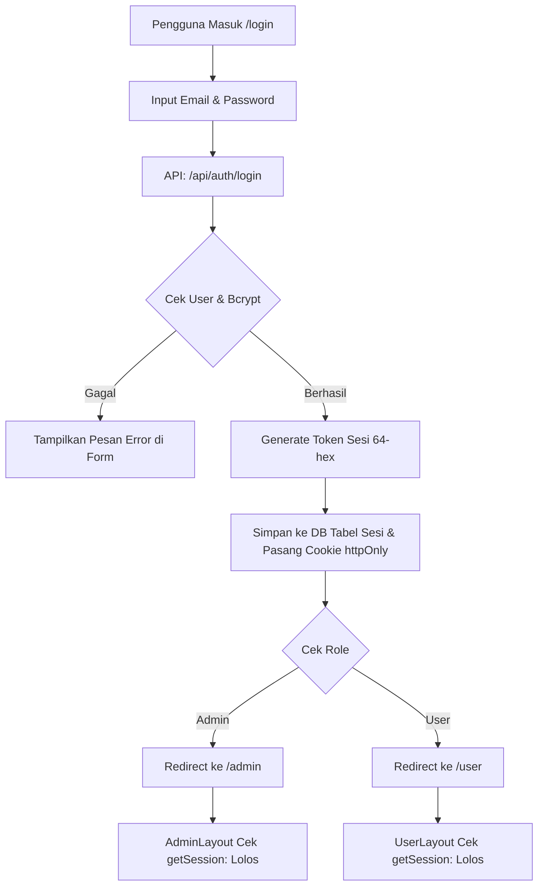

# 📚 Dokumentasi Lengkap Menu & Logika Kode: Inven Sekolah

Dokumen ini memuat daftar lengkap seluruh menu pada aplikasi **Inven Sekolah (Sistem Inventaris Sekolah)**, alur logika bisnis, struktur halaman, serta penjelasan sintaks kode di sisi Frontend dan Backend.

---

## 📑 Daftar Isi
1. [Arsitektur Sistem & Autentikasi](#1-arsitektur-sistem--autentikasi)
   - [Halaman Login (`/login`)](#halaman-login-login)
   - [Halaman Register (`/register`)](#halaman-register-register)
   - [Sistem Sesi & Keamanan (`src/lib/auth.ts`)](#sistem-sesi--keamanan-srclibauthts)
   - [Server Guard & Role Gatekeeper (`layout.tsx`)](#server-guard--role-gatekeeper-layouttsx)
2. [Menu Panel Admin (`/admin`)](#2-menu-panel-admin-admin)
   - [Beranda / Dashboard Admin (`/admin`)](#a-beranda--dashboard-admin-admin)
   - [Kelola Pengguna (`/admin/pengguna`)](#b-kelola-pengguna-adminpengguna)
   - [Kelola Jenis Barang (`/admin/jenis_barang`)](#c-kelola-jenis-barang-adminjenis_barang)
   - [Kelola Katalog & Unit Fisik Serial Number (`/admin/barang`)](#d-kelola-katalog--unit-fisik-serial-number-adminbarang)
   - [Kelola Transaksi Peminjaman (`/admin/transaksi`)](#e-kelola-transaksi-peminjaman-admintransaksi)
   - [Pengaturan Akun Admin (`/admin/pengaturan`)](#f-pengaturan-akun-admin-adminpengaturan)
   - [Pusat Bantuan Admin (`/admin/bantuan`)](#g-pusat-bantuan-admin-adminbantuan)
3. [Menu Panel User / Peminjam (`/user`)](#3-menu-panel-user--peminjam-user)
   - [Beranda User (`/user`)](#a-beranda-user-user)
   - [Katalog & Pengajuan Peminjaman (`/user/barang`)](#b-katalog--pengajuan-peminjaman-userbarang)
   - [Riwayat Transaksi & Pembatalan (`/user/transaksi`)](#c-riwayat-transaksi--pembatalan-usertransaksi)
   - [Pengaturan Akun User (`/user/pengaturan`)](#d-pengaturan-akun-user-userpengaturan)
   - [Pusat Bantuan User (`/user/bantuan`)](#e-pusat-bantuan-user-userbantuan)
4. [Penjelasan Sintaks Penting & Pola Koding](#4-penjelasan-sintaks-penting--pola-koding)

---

## 1. Arsitektur Sistem & Autentikasi



---

### Halaman Login (`/login`)
* **Path File**: `src/app/login/page.tsx`
* **Tujuan**: Mengumpulkan kredensial pengguna, mengirimkannya ke backend, dan mengarahkan ke dashboard yang tepat berdasarkan role.

#### Potongan Kode Utama:
```tsx
// Penanganan submit form login
async function handleSubmit(e: React.FormEvent) {
  e.preventDefault(); // Mencegah reload halaman
  setError("");
  setLoading(true);

  try {
    const res = await fetch("/api/auth/login", {
      method: "POST",
      headers: { "Content-Type": "application/json" },
      body: JSON.stringify({ email, password }),
    });

    const result = await res.json();

    if (!res.ok) {
      setError(result.error || "Email atau password salah");
      setLoading(false);
      return;
    }

    // Arahkan ke dashboard sesuai role yang dikembalikan server
    const tujuan = result.data.role === "Admin" ? "/admin" : "/user";
    router.push(tujuan);
    router.refresh(); // Memaksa layout membaca cookie sesi baru
  } catch {
    setError("Tidak dapat terhubung ke server");
    setLoading(false);
  }
}
```

#### Penjelasan Sintaks:
1. `e.preventDefault()`: Mencegah reload penuh browser agar form ditangani secara asynchronous lewat JavaScript (SPA behavior).
2. `fetch("/api/auth/login", ...)`: Mengirimkan HTTP POST berisi payload JSON `{ email, password }`.
3. `result.data.role === "Admin" ? "/admin" : "/user"`: Operator ternary untuk menentukan routing tujuan secara dinamis.
4. `router.refresh()`: Memperbarui Server Component pada Next.js agar server membaca cookie sesi yang baru diset.

---

### Sistem Sesi & Keamanan (`src/lib/auth.ts`)
* **Tujuan**: Menangani pembuatan token sesi kriptografis, penyimpanan di tabel `Sesi` MySQL, dan cookie browser `httpOnly`.

#### Potongan Kode Utama:
```typescript
const COOKIE_NAME = "session_token";
const SESSION_DURATION_MS = 1000 * 60 * 60 * 24 * 7; // Berlaku 7 hari

export async function createSession(penggunaId: string) {
  // 1. Generate token 64 karakter heksadesimal acak
  const token = randomBytes(32).toString("hex");
  const expiresAt = new Date(Date.now() + SESSION_DURATION_MS);

  // 2. Simpan sesi ke database
  await prisma.sesi.create({
    data: { token, penggunaId, expiresAt },
  });

  // 3. Tanam ke cookie browser
  const cookieStore = await cookies();
  cookieStore.set(COOKIE_NAME, token, {
    httpOnly: true, // Tidak bisa dibaca JavaScript browser (kebal XSS)
    secure: process.env.NODE_ENV === "production",
    sameSite: "lax", // Menangkal serangan CSRF
    expires: expiresAt,
    path: "/",
  });
}
```

#### Penjelasan Sintaks:
1. `randomBytes(32).toString("hex")`: Menghasilkan string acak dengan entropi tinggi yang mustahil ditebak.
2. `httpOnly: true`: Parameter keamanan wajib yang melarang `document.cookie` di browser mengakses cookie ini.

---

### Server Guard & Role Gatekeeper (`layout.tsx`)
* **Path File**:
  - `src/app/admin/layout.tsx` (Pelindung area Admin)
  - `src/app/user/layout.tsx` (Pelindung area User)
* **Tujuan**: Mengecek keabsahan sesi dan role di level Server Component sebelum HTML halaman dikirim ke browser.

#### Potongan Kode Utama (`src/app/admin/layout.tsx`):
```typescript
export default async function AdminLayout({
  children,
}: Readonly<{ children: React.ReactNode }>) {
  const pengguna = await getSession();

  if (!pengguna) {
    redirect("/login");
  }

  if (pengguna.role !== "Admin") {
    redirect("/unauthorized"); // Tolak jika bukan Admin
  }

  return (
    <div className="flex min-h-screen bg-[#101111] text-zinc-100">
      <Sidebar />
      <div className="min-w-0 flex-1">{children}</div>
    </div>
  );
}
```

#### Penjelasan Sintaks:
1. `await getSession()`: Berjalan di server, membaca cookie `session_token`, lalu mencocokkannya ke database.
2. `redirect("/unauthorized")`: Fungsi pengalihan instan Next.js jika pengguna tidak memiliki izin (HTTP 403).

---

## 2. Menu Panel Admin (`/admin`)

### A. Beranda / Dashboard Admin (`/admin`)
* **Path File**: `src/app/admin/page.tsx`
* **Logika**:
  - Mengambil data katalog, jenis barang, pengguna, dan transaksi secara paralel menggunakan `Promise.all`.
  - Menghitung statistik kartu (Total Barang, Siap Dipinjam, Total Pengguna, Peminjaman Aktif).
  - Menyediakan fitur **Persetujuan Cepat (Quick Action)** untuk menyetujui (`DIPINJAM`) atau menolak (`DITOLAK`) permohonan peminjaman yang berstatus `MENUNGGU`.

#### Potongan Sintaks Quick Action:
```typescript
const handleUpdateStatus = async (id: string, status: "DIPINJAM" | "DITOLAK") => {
  setProcessingId(id);
  try {
    const res = await fetch(`/api/transaksi/${id}`, {
      method: "PATCH",
      headers: { "Content-Type": "application/json" },
      body: JSON.stringify({ status }),
    });
    if (res.ok) {
      toast.success(status === "DIPINJAM" ? "Disetujui" : "Ditolak");
      loadDashboardData(); // Refresh statistik dan daftar tunggu
    }
  } finally {
    setProcessingId(null);
  }
};
```

---

### B. Kelola Pengguna (`/admin/pengguna`)
* **Path File**:
  - Daftar: `src/app/admin/pengguna/page.tsx`
  - Form Tambah/Edit: `src/app/admin/pengguna/hal_pengguna/page.tsx`
* **Logika & Aturan Bisnis**:
  - Menampilkan daftar seluruh pengguna dengan filter role (`Admin`, `User`) dan status (`Active`, `Inactive`).
  - **Proteksi Admin Terakhir**: Sistem melarang menghapus atau mengubah role admin jika hanya tersisa 1 akun Admin aktif.
  - Password baru otomatis di-hash menggunakan `bcrypt.hash(password, 10)`.

#### Potongan Proteksi Admin Terakhir (`src/app/api/pengguna/[id]/route.ts`):
```typescript
if (targetUser.role === "Admin") {
  const adminCount = await prisma.pengguna.count({
    where: { role: "Admin", status: "Active" },
  });
  if (adminCount <= 1) {
    return NextResponse.json(
      { error: "Tidak dapat menghapus atau menonaktifkan admin terakhir di sistem" },
      { status: 400 }
    );
  }
}
```

---

### C. Kelola Jenis Barang (`/admin/jenis_barang`)
* **Path File**:
  - Daftar: `src/app/admin/jenis_barang/page.tsx`
  - Form: `src/app/admin/jenis_barang/hal_jbarang/page.tsx`
* **Logika**:
  - Menampilkan nama kategori, deskripsi, dan menghitung jumlah barang yang terhubung (`_count: { barang: true }`).
  - **Integritas Relasi**: Kategori yang masih digunakan oleh barang di katalog tidak boleh dihapus.

#### Potongan Validasi Relasi:
```typescript
const kategori = await prisma.jenisBarang.findUnique({
  where: { id },
  include: { _count: { select: { barang: true } } },
});

if (kategori._count.barang > 0) {
  return NextResponse.json(
    { error: "Kategori tidak dapat dihapus karena masih digunakan oleh barang" },
    { status: 400 }
  );
}
```

---

### D. Kelola Katalog & Unit Fisik Serial Number (`/admin/barang`)
* **Path File**:
  - Daftar Katalog: `src/app/admin/barang/page.tsx`
  - Tambah Barang: `src/app/admin/barang/hal_barang/page.tsx`
  - Edit & Kelola Unit: `src/app/admin/barang/[id]/page.tsx`
  - Komponen Unit Input: `src/components/kelola_barang/tambah_barang/UnitInputCard.tsx`
  - Komponen Unit Edit: `src/components/kelola_barang/KelolaUnitSection.tsx`

#### Logika Inti:
1. **Pemisahan Katalog vs Unit Fisik**:
   - `Barang`: Informasi umum (nama, kategori, SKU, merek, deskripsi).
   - `UnitBarang`: Fisik riil barang dengan **Serial Number (SN) unik**, kondisi (`BAIK`, `RUSAK_RINGAN`, `RUSAK_BERAT`), dan status (`TERSEDIA`, `DIPINJAM`, `RUSAK`, `HILANG`).
2. **Sinkronisasi Stok Otomatis**:
   - Kolom `stok` pada tabel katalog dihitung otomatis dari total unit fisik yang berstatus `TERSEDIA`.
3. **Bulk Serial Number Generator**:
   - Admin dapat memasukkan awalan (contoh `LAPTOP-`) dan nomor awal-akhir (contoh `1` s/d `5`) yang otomatis menghasilkan array `["LAPTOP-001", "LAPTOP-002", ..., "LAPTOP-005"]`.

#### Potongan Generator SN:
```typescript
const handleGenerateBulk = () => {
  const start = parseInt(bulkStart, 10);
  const end = parseInt(bulkEnd, 10);
  const pad = parseInt(bulkPad, 10) || 3;
  const newSNs: string[] = [];

  for (let i = start; i <= end; i++) {
    const sn = `${bulkPrefix}${String(i).padStart(pad, "0")}`;
    if (!serialNumbers.includes(sn)) {
      newSNs.push(sn);
    }
  }
  onChange([...serialNumbers, ...newSNs]);
};
```

---

### E. Kelola Transaksi Peminjaman (`/admin/transaksi`)
* **Path File**:
  - Daftar: `src/app/admin/transaksi/page.tsx`
  - Catat Pinjam Manual: `src/app/admin/transaksi/hal_catatbarang/page.tsx`

#### Siklus Status Transaksi & Sinkronisasi Unit Fisik:
```
[Transaksi: MENUNGGU]
         │
         ├──► Admin Setujui (DIPINJAM)
         │       └── UnitBarang.status = "DIPINJAM"
         │       └── Barang.stok -= 1
         │
         └──► Admin Kembalikan (DIKEMBALIKAN)
                 └── UnitBarang.status = "TERSEDIA"
                 └── Barang.stok += 1
                 └── Transaksi.tanggalKembali = Sekarang
```

#### Potongan Pengembalian Barang (`src/app/api/transaksi/[id]/route.ts`):
```typescript
if (status === "DIKEMBALIKAN") {
  updateData.tanggalKembali = new Date();

  // Kembalikan unit fisik menjadi TERSEDIA
  if (currentTransaksi.unitId) {
    await prisma.unitBarang.update({
      where: { id: currentTransaksi.unitId },
      data: { status: "TERSEDIA" },
    });
  }

  // Hitung ulang stok katalog yang tersedia
  const stokTersedia = await prisma.unitBarang.count({
    where: { barangId: currentTransaksi.barangId, status: "TERSEDIA" },
  });

  await prisma.barang.update({
    where: { id: currentTransaksi.barangId },
    data: {
      stok: stokTersedia,
      status: stokTersedia > 0 ? "TERSEDIA" : "HABIS",
    },
  });
}
```

---

### F. Pengaturan Akun Admin (`/admin/pengaturan`)
* **Path File**: `src/app/admin/pengaturan/page.tsx` (Menggunakan komponen `src/components/pengaturan/PengaturanAkun.tsx`)
* **Logika**:
  - Memperbarui profil (nama dan email yang divalidasi keunikan).
  - Mengubah password: Wajib memverifikasi password saat ini via `bcrypt.compare` sebelum memperbarui password baru (minimal 6 karakter).

---

### G. Pusat Bantuan Admin (`/admin/bantuan`)
* **Path File**: `src/app/admin/bantuan/page.tsx`
* **Logika**:
  - Menampilkan FAQ interaktif (accordion buka/tutup state `openFaqIndex`).
  - Pencarian panduan dan kartu kategori bantuan (Panduan Pengguna, FAQ, Lapor Masalah, Hubungi Dukungan).

---

## 3. Menu Panel User / Peminjam (`/user`)

### A. Beranda User (`/user`)
* **Path File**: `src/app/user/page.tsx`
* **Logika**:
  - Menampilkan statistik katalog barang dan jumlah pinjaman aktif milik akun user yang sedang login.

---

### B. Katalog & Pengajuan Peminjaman (`/user/barang`)
* **Path File**: `src/app/user/barang/page.tsx`
* **Logika**:
  - Menampilkan barang yang memiliki unit tersedia (`stok > 0`).
  - Modal peminjaman: User memilih **Unit Fisik (Serial Number)** tertentu dan dapat melihat kondisi fisiknya (Baik, Rusak Ringan).
  - Status peminjaman baru otomatis diset ke **`MENUNGGU`**.

#### Potongan Dialog Peminjaman:
```tsx
const handleAjukanPinjam = async (e: React.FormEvent) => {
  e.preventDefault();
  setIsSubmitting(true);

  const res = await fetch("/api/transaksi", {
    method: "POST",
    headers: { "Content-Type": "application/json" },
    body: JSON.stringify({
      barangId: selectedBarang.id,
      unitId: selectedUnitId, // Terikat pada 1 Serial Number spesifik
      jumlah: 1,
      tanggalPinjam,
      tenggatWaktu,
      keperluan,
    }),
  });
  // Tangani feedback toast & refresh data
};
```

---

### C. Riwayat Transaksi & Pembatalan (`/user/transaksi`)
* **Path File**: `src/app/user/transaksi/page.tsx`
* **Logika**:
  - Menampilkan riwayat peminjaman user bersangkutan lengkap dengan badge Serial Number unit yang dipinjam.
  - **Tombol Batalkan**: Hanya muncul untuk transaksi yang statusnya masih **`MENUNGGU`** (belum disetujui admin). Jika sudah `DIPINJAM`, tombol dinonaktifkan.

---

### D. Pengaturan Akun User (`/user/pengaturan`)
* **Path File**: `src/app/user/pengaturan/page.tsx`
* **Logika**: Sama dengan admin, memungkinkan user mengubah nama, email, dan password mandiri.

---

### E. Pusat Bantuan User (`/user/bantuan`)
* **Path File**: `src/app/user/bantuan/page.tsx`
* **Logika**: FAQ dan panduan cara meminjam barang serta aturan pengembalian bagi siswa/guru/staf.

---

## 4. Penjelasan Sintaks Penting & Pola Koding

| Sintaks / Fitur | Contoh Kode | Penjelasan & Manfaat |
|---|---|---|
| **Server Component Fetching** | `const session = await getSession()` | Berjalan langsung di server Node.js sebelum HTML dikirim ke browser, menjamin keamanan autentikasi tanpa kedip layar (*flicker*). |
| **Atomic Prisma Transaction** | `await prisma.unitBarang.createMany(...)` | Memastikan pembuatan banyak unit fisik sekaligus berjalan secara aman. |
| **Bcrypt Compare** | `await bcrypt.compare(plain, hash)` | Menguji password tanpa pernah mendeskripsikan hash di database, tahan terhadap *timing attack*. |
| **Dynamic Routing** | `src/app/admin/barang/[id]/page.tsx` | Next.js menangkap parameter URL dinamis via `params.id` untuk halaman detail/edit. |
| **Computed Stock State** | `status: stok > 0 ? "TERSEDIA" : "HABIS"` | Nilai status katalog tidak lagi ditentukan manual oleh admin, melainkan dihitung secara otomatis berdasarkan ketersediaan unit fisik riil. |

---

*Dokumen ini diperbarui secara otomatis sesuai dengan codebase sistem inventaris terkini.*
